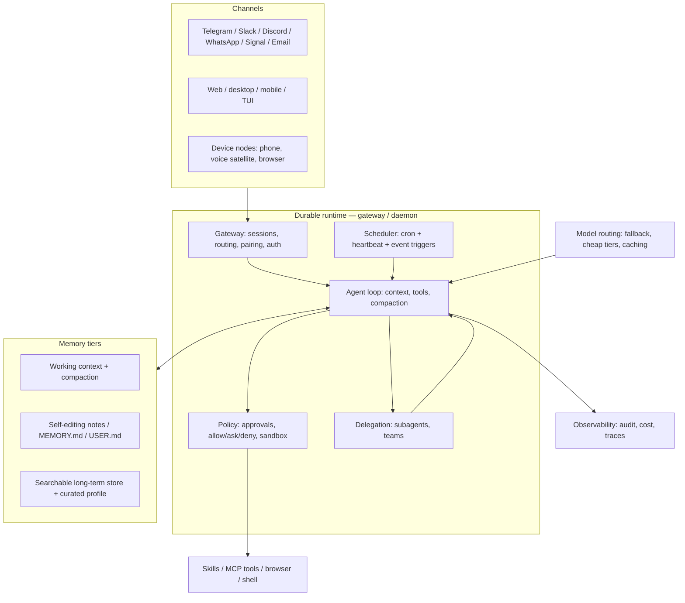

# Turning DSH into a personal AI assistant

*Research report, 2026-11-09. Question: how could DeepSeek Harness (`dsh` v0.2.2-rc.1) become a
personal AI assistant in the style of **Hermes Agent** and **OpenClaw**, and what is being done in this
space?*

Companion research notes (same directory, each cited independently):

- [`hermes.md`](hermes.md) — Hermes Agent architecture, from the real local install (`~/.hermes`, v0.23.0) and its docs.
- [`openclaw.md`](openclaw.md) — OpenClaw architecture, channels, memory, security, ecosystem (primary docs).
- [`landscape.md`](landscape.md) — adjacent projects (Letta, Goose, Open Interpreter, Kortix, Manus, DIY setups), the convergent architecture, hard problems.
- [`dsh-audit.md`](dsh-audit.md) — what the installed DSH actually ships, package by package.
- [`dsh-ecosystem.md`](dsh-ecosystem.md) — the 4,872-plugin community market, mined for assistant-shaped plugins.

Methods: local read-only inspection of this host (DSH install and `~/.dsh`, Hermes install `~/.hermes`),
the DSH documentation site, the plugin market index, and primary project docs. No secrets were read or
copied. Claims about specific products are cited inline; a shared Sources section is at the end.

---

## TL;DR

1. **The space has converged on one architecture**: a general-purpose *coding-agent harness* wrapped in an
   *always-on runtime* that adds chat channels, memory tiers, scheduling/heartbeat, a permission/policy
   layer, and a persona. Hermes and OpenClaw are two expressions of it; Letta, Goose, Kiro/Kortix, Manus and
   the "Claude Code + Telegram" DIY setups are others. The harness half is commoditised; the differentiators
   are channels, memory curation, proactivity and trust.
2. **DSH already owns the commoditised half.** Agent loop, compaction, sessions (event-sourced, persisted,
   FTS5-searchable), sandbox, approvals/permission presets, skills, MCP client, subagents, agent teams,
   goals, scheduled tasks, a web GUI, plus headless/SDK/ACP entry modes and OTel telemetry.
3. **DSH is missing the assistant half**: a long-lived chat-channel runtime (Telegram/Slack/Discord/…), a
   self-editing memory layer, channel-aware approvals, proactive heartbeat/event triggers, and a
   human-readable "what did it do while I slept" surface. None of these requires rewriting DSH: they are
   plugin-shaped against existing seams.
4. **The community has already built most of them.** The DSH plugin market lists **4,872 plugins**; catalog
   categories alone include 212 memory, 160 notify, 155 remote, 74 voice and 61 identity plugins, and
   keyword scans find ~130 IM/channel bridges (Telegram, Discord, Slack, Feishu/Lark, WeChat, QQ, DingTalk,
   one WhatsApp) and ~277 proactivity/heartbeat/scheduler plugins. Two projects already package most of the
   stack: `dsh-bao` (memory + digest + notifications + assistant preset) and
   `@starsharryzhu/dsh-assistant` (router/worker agents + heartbeat + daily brief + WeChat bridge). The gap
   is **integration, hardening and productisation — not primitives**.
5. **Highest-leverage first step**: stand up a separate `assistant` DSH profile that composes a channel
   gateway + one memory system + schedule/heartbeat + persona + notify, behind DSH's existing
   approval/sandbox policy. That is a days-not-months MVP.
6. **Highest-leverage product step**: a curated, tested **"DSH Personal Assistant" bundle** (profile
   template + a small number of vetted plugins + a security profile + acceptance tests), plus the two
   upstream seams the ecosystem lacks: a **channel/inbox seam** (`ctx.channels`) and a **channel-aware
   approval policy**.
7. **Do not clone OpenClaw/Hermes.** Interop instead: MCP for integrations, `SKILL.md` for skills,
   ACP/SDK for driving DSH from (or as) another agent. Hermes already runs on this host and exposes ACP —
   a hybrid is a legitimate short-term path.
8. **Security is the real product problem.** Every channel is attacker-controlled input; a personal
   assistant that reads private data and can send messages satisfies all three legs of the "lethal
   trifecta". OpenClaw's early 2026 incidents (CVE-2026-25253, a context-compression deletion accident,
   poisoned skills) are the cautionary tale: enforce trust boundaries in code, default-deny unknown
   senders, and treat inbound content as untrusted from day one.

---

## 1. What is being done in this space

### 1.1 Three lineages converged

- **Memory-first agents** (MemGPT → Letta): the context window is a managed resource the agent edits;
  memory blocks, size caps, idle-time rewriting, provenance. See
  [MemGPT](https://arxiv.org/abs/2310.08560), [Letta memory blocks](https://www.letta.com/blog/memory-blocks).
- **Coding agents** (Claude Code, Codex, their clones): a general-purpose loop with shell/files/sandbox/
  skills/subagents/MCP — the first harnesses capable enough to actually do work on a real machine.
- **Workflow automation** (n8n, Activepieces): triggers, connectors, approvals — but graph-first, not
  conversation-first.

The synthesis is now the market's default: Letta Code calls itself "a stateful agent harness… agents that
have memory, identity, and a sense of experience over time" and ships Telegram/Slack/Discord channels,
crons and heartbeats ([letta-code](https://github.com/letta-ai/letta-code)); Open Interpreter became "a
coding agent optimized for low-cost models", a Rust Codex fork with ACP and sandboxing
([README](https://github.com/OpenInterpreter/open-interpreter)); Goose is a desktop/CLI/API harness with
70+ MCP extensions ([README](https://github.com/aaif-goose/goose)); and Claudex is literally Claude Code +
a Telegram plugin + hooks + cron + systemd ([README](https://github.com/JansenAnalytics/claudex)).
Google shipped a 24/7 cloud-VM personal agent (Gemini Spark, I/O May 2026) and Tencent/Alibaba/Z.ai
shipped OpenClaw-style wrappers in China — the category is now mainstream. See
[`landscape.md`](landscape.md) for the full survey and repo metadata.

### 1.2 The two reference designs to learn from

**OpenClaw — gateway-first.** One long-lived Gateway owns every messaging surface and is the only
process that opens sessions like WhatsApp; thin clients (macOS app, CLI, web Control UI, nodes) connect
over a typed WebSocket protocol on `127.0.0.1:18789`. ~30 channel integrations (WhatsApp/Telegram/Slack/
Discord/iMessage/Signal/Matrix/Teams/… ), per-chat session routing, DM pairing codes, group allowlists and
mention gates, device "nodes" exposing camera/screen/location/SMS/contacts/calendar, `SOUL.md` persona,
`USER.md`/`MEMORY.md`/daily-notes memory with "dreaming" consolidation, and Automations (cron + event
triggers + webhooks) with delivery to a chat. Security is "one trust boundary per Gateway": trusted
gateway, untrusted movable execution, pairing and approvals enforced in code — though sandboxing and exec
approvals ship **off** by default, and that gap produced real incidents.
Sources: [architecture](https://docs.openclaw.ai/concepts/architecture),
[channels](https://docs.openclaw.ai/channels), [memory](https://docs.openclaw.ai/concepts/memory),
[automations](https://docs.openclaw.ai/automation/cron-jobs/how-it-works),
[security](https://docs.openclaw.ai/gateway/security).

**Hermes Agent — agent-OS.** One Python `AIAgent` core behind many entry points (CLI, gateway, TUI,
Electron, ACP) with a 25+ adapter messaging gateway in one daemon; default-deny auth with DM pairing;
session keys `agent:{profile}:{platform}:{chat_type}:{chat_id}`; first-class cron (jobs.json +
executions.db ledger + deliveries.db queue, pre-dispatch validation that spends zero tokens on broken
jobs, catch-up, failure incidents); a deliberately small memory layer (`MEMORY.md` 2,200 chars +
`USER.md` 1,375 chars injected as a frozen session-start snapshot, agent-edited through
add/patch/remove, overflow forces consolidation, injection scanning) with FTS5 session search as the
unbounded tier; skills as procedural memory with progressive disclosure, a curator lifecycle and a
scanned hub; durable subagents and a kanban board; layered approvals with per-surface unattended modes
that default to deny; voice; and "Bot Mode" (profiles as a roster of named bots with routines and group
chats). Sources: official docs at <https://hermes-agent.nousresearch.com/docs/> and the local install
(see [`hermes.md`](hermes.md)).

### 1.3 The recurring ten-layer stack

Both designs, and nearly every serious project in the survey, are the same stack with different ownership
(adapted from [`landscape.md`](landscape.md)):



**Commoditised** already: tool loops, MCP, Markdown skills, basic sandboxing, provider abstraction.
**Still differentiating**: channel breadth and reliability, memory curation quality, proactivity that is
useful rather than noisy, and the trust/policy layer.

### 1.4 What makes one *feel* like a personal assistant

Distilled from both products (and their users):

1. **It meets you where you already are** — a contact in WhatsApp/Telegram/Slack, not an app you open.
2. **It remembers you across sessions**, in a bounded, inspectable, correctable way.
3. **It initiates** — reminders, briefings, monitors, event triggers; it messages you first.
4. **It has hands** — files, shell, browser, code execution, MCP tools.
5. **It has a body** (OpenClaw's nodes; Hermes' voice) — camera, location, calendar, voice.
6. **It has a persona** — a name and a stable voice (`SOUL.md` as prompt slot #1).
7. **It is one continuous relationship** — same memory and sessions across devices and channels.
8. **It is allowed to do real things** — with a policy layer that scales from "ask me every time" to
   "deny by default when nobody is watching".

---

## 2. DSH today: an assistant engine without the assistant shell

### 2.1 Architecture in one page

DSH is a Cordis-based, "everything is a plugin" harness. A running `dsh` is a plugin tree composed at boot
from ordered layers: a **profile** (named composition under `$DSH_HOME/profiles/<name>`) lists **bundles**,
each bundle contributes patch layers, then the profile's own `cordis.patch.yml`, the home patch, and
`--patch` overlays. Anything a bundle inserts can be replaced by a patch at a higher layer
([architecture](https://deepseek-harness.github.io/deepseek-harness/en/reference/index.md)).

- **Shipped bundles**: `dsh-base` (model adapters, tools, persistence, sandbox/approval policy, settings,
  credentials, telemetry), `dsh-web-app` (browser app: sessions, schedule page, files, terminal, goal,
  jobs, plugins, approvals), `dsh-headless` (one-shot runner), `dsh-sdk-app` / `dsh-sdk-minimal`
  (JSON-RPC stdio automation), `dsh-acp-app` (ACP for editors).
- **Seams** are the extension pattern: a Service Definition + Provider + Consumer around `ctx.llm`,
  `ctx.tools`, `ctx.fs`, `ctx.sandbox`, `ctx.storage`, `ctx.sessions`, `ctx.subagents`, `ctx.schedule`,
  `ctx.approval`, `ctx.webhookRuntime`… plus event waterfalls (`agent/pre-step`, `agent/request`,
  `llm/stream`, `tools/pre-execute|execute|post-execute`). New behavior attaches to a documented point;
  "add a model-facing capability" = register on `ctx.tools`; "start a Session from an external webhook" =
  register a trusted rule on `ctx.webhookRuntime` and mount a provider adapter.
- **Sessions** are an append-only event log (JSONL persistence, projections, SQLite FTS5 query,
  cross-session references, compaction with image offload/tool-result pruning). The model only sees what
  is logged — a useful invariant for auditability.
- **Assistant-relevant shipped primitives** (verified in the 330-package install; see
  [`dsh-audit.md`](dsh-audit.md)): `dsh-schedule` + `dsh-tool-schedule` (host-wide durable reminders,
  cron/RRULE, delivery to existing or new sessions, survive restarts); `dsh-goal` + goal-round driver;
  `dsh-mcp-client` + `dsh-mcp-resources` (any MCP server becomes tools `mcp__<server>__<tool>`);
  `dsh-skill*` (SKILL.md providers with progressive loading); `dsh-subagent*` (in-process spawn/fork, plus
  ACP/Codex/Claude-Code backends); `dsh-experimental-agent-team*` (durable roster, peer messaging, task
  board); `dsh-jobs` (background jobs); `dsh-permission-presets`, `dsh-user-approval`, sandbox backends
  (Landlock/Bash sandbox on Linux here), `dsh-experimental-auto-review` (LLM pre-tool authorization);
  `dsh-experimental-voice-input` + SenseVoice STT; `dsh-persona` (per-preset prompt persona); web GUI with
  approvals/questions/Schedule page; `dsh-experimental-liveshare` (share a live session over a relay).
- **Explicitly not shipped** (the three missing pillars): (1) any IM/messaging channel adapter — zero in
  the 330-package tree; (2) outbound notification/delivery — scheduled prompts land in a session inbox or
  GUI only, with no OS/phone push and no TTS in core; (3) a long-term memory store — session history is
  durable, but cross-session search is an optional bundle with an in-memory, lazy index (`openAt: never`
  in the Web profile), and there are no memory tools or injected memory block. Also missing: a
  channel-aware approval transport, a heartbeat primitive, and a blessed hooks/trigger bundle — although
  `dsh-webhook`, `dsh-webhook-github` and hook-bridge packages are published on npm but not shipped
  (`@deepseek-ai/dsh-webhook@0.1.2-alpha.2` etc.). The only shipped external-input seams are the
  experimental `ctx.webhookRuntime` (a GitHub provider adapter exists) and the authenticated Remote API
  the web client uses.

### 2.2 What the assistant stack needs vs what DSH has

| Layer | Needed (per Hermes/OpenClaw) | DSH 0.2.2-rc.1 | Where |
|---|---|---|---|
| Durable runtime | daemon owning sessions/channels/schedule | **Shipped** — `dsh web` is a long-lived host; headless/SDK/ACP too; sessions persist across restarts | core |
| Chat channels | Telegram/Slack/Discord/WhatsApp/email + routing, pairing, per-chat sessions | **Missing in core; community plugins exist** (~130) | plugin |
| Agent loop / tools | context assembly, tools, compaction, sandbox | **Shipped** (commodity half) | core |
| Memory | self-editing bounded notes + searchable long-term + curation | **Missing in core**: session persistence, FTS5 query and session refs exist, but no memory store/tools/curation; cross-session search is optional + in-memory | plugin/MCP |
| Scheduling / proactivity | cron + heartbeat + event triggers + delivery | **Partial**: `dsh-schedule` (cron/RRULE, delivery, durable, at-least-once); no heartbeat or event-triggered loops in core | core + plugin |
| Outbound notifications | push to phone/desktop when attention is needed | **Missing in core** — no push/desktop notifications, no TTS; community notify plugins exist | plugin |
| Skills | SKILL.md, progressive disclosure, curation, hub | **Loader shipped**; no curator/hub/usage telemetry | core + plugin |
| MCP / integrations | MCP client, resources, OAuth | **Shipped client** (`dsh-mcp-client`), official memory-MCP examples | core |
| Policy / approvals | allow/ask/deny per tool+channel, unattended defaults, sandbox | **Shipped for web**: permission presets, approvals, sandbox, auto-review; **not channel-aware** | core + plugin |
| Delegation | subagents, teams, durable boards | **Shipped**: subagents (+ACP/Codex/CC), experimental agent teams; no kanban | core |
| Voice | STT/TTS, voice notes, wake word | **Partial**: experimental voice input + SenseVoice STT; no TTS in core | core + plugin |
| Remote/mobile | pairing, mobile UI, push | **Partial**: loopback web + `--public-url`/`--trusted-host`/TLS; community phone remotes (mobile-remote installed here), tailnet gateway — no native app or push | core + plugin |
| Persona | identity file, stable voice | **Partial**: `dsh-persona` row, per-preset system prompt; no memory-linked identity | core |
| Observability | audit, "what happened while away", cost | **Partial**: OTel telemetry, session logs, job/trajectory UI; no human digest | core + plugin |
| Model routing / cost | fallback, cheap aux slots, budgets | **Partial**: providers, retries; no per-task aux slots/budgets | plugin |

### 2.3 The ecosystem already assembles assistants

DSH's plugin market (index served from npm/GitHub, browsable in Plugins → Discover; the host here has
`dshmarket` and a market index installed) lists **4,872 plugins**. Mined by keyword (2026-11-09;
[`dsh-ecosystem.md`](dsh-ecosystem.md)):

- **Channels (~130)**: `@goodandready/dsh-messenger-gateway` (Telegram bidirectional + TTS voice notes),
  `@xmanrui/dsh-im` (9 channels via QR/bot credentials incl. WhatsApp),
  `dsh-im-channel` (Feishu/Telegram/DingTalk/Slack/Discord, streaming), `dsh-tg-bridge` (topic-per-project,
  voice/photo, per-topic goals), `dsh-switchboard` (approvals/questions as buttons),
  `dsh-slack`, `@addozhang/dsh-discord`, `dsh-feishu-board` (routes `ask_user_question` to Feishu DM and
  the reply back to the exact session), `dsh-channel-qq`, `dsh-im-hub`, `dsh-connect`.
- **Memory (~229)**: Claude-Code-style `MEMORY.md` (`dsh-auto-memory`), six-tier staging
  (`dsh-memory-tiers`), hippocampus/day-diary (`dsh-layers-hippocampus`), proactive consolidation
  (`@a9i5k4/dsh-auto-memory`), audience-gated persona/diary (`feiyu-memory`), PostgreSQL+MCP
  (`dsh-butler-memory`); plus official MCP memory servers (Memorix, MCP Reference Memory, Engram) via
  `dsh-mcp-client`.
- **Proactivity (~277)**: `@kanadego/dsh-heartbeat` (wakes on its own schedule and browses interests),
  `dsh-monitor` (watchers that wake the agent), `dsh-tick`/`@opendsh/dsh-plugin-scheduled-tasks`,
  `dsh-automations` (lifecycle hooks + cron), `dsh-rss-digest`, `dsh-mishu` (GitHub-notification
  secretary), `dsh-work-assistant` (WeChat task ledger + reminders).
- **Voice (~111)**, **remote/mobile (155 in the `remote` category)**, **persona/identity (61)** —
  including an installed mobile-remote plugin with QR pairing and phone image upload.

So a Hermes/OpenClaw-shaped assistant is already assemblable from the market today. Two projects even
bundle most of the stack: **`dsh-bao`** (MIT, `github.com/milestone-17/dsh-bao`) ships long-term memory
(`bao_remember/recall/forget` over a JSON store injected as system-prompt runtime context), a dedicated
assistant agent preset with persona, a daily digest, notifications and a read-only sidebar API;
**`@starsharryzhu/dsh-assistant`** (npm 0.2.2, desktop-only) ships router + worker agents, hourly
heartbeat, quiet hours, daily brief and a WeChat bridge (`@starsharryzhu/im-robot`). Both are young: the
`dsh-bao` README claims a `notify_user` tool that is absent from this 0.2.2-rc.1 install, so verify
against the matching DSH build. What is not there is a **curated, tested combination**, a **shared
channel seam**, and **host-level trust policy for external channels** — the integration layer is the gap.

---

## 3. The five gaps that actually matter

1. **A channel/inbox layer with real routing.** Today every gateway plugin invents its own inbox, pairing
   and delivery. There is no `ctx.channels` seam, no shared "conversation ↔ session" binding model, no
   host-level per-sender authorization, no standard way to map approvals back to a chat. This is the
   difference between "a plugin that talks to Telegram" and "an assistant". It is plugin-shaped, with one
   upstream seam proposal.
2. **Memory as a first-class, curated layer.** DSH has storage, session persistence and FTS5 session
   search — not memory. What Hermes/OpenClaw/Letta converged on: a small always-in-prompt curated block
   (`USER.md`/`MEMORY.md`), an unbounded searchable tier, an out-of-band curator that consolidates (and
   forgets), provenance, and a write policy. 229 community plugins exist; the hard part is *curation
   quality*, not storage.
3. **Channel-aware policy and the trust boundary.** DSH's approval UX assumes a web client and a human at
   the terminal. An always-on assistant needs: default-deny unknown senders, pairing, per-channel
   allowlists, untrusted-content provenance on inbound messages, approvals routed to chat with timeouts,
   unattended modes that fail closed, and a hardline command floor. OpenClaw's 2026 incidents and Meta's
   "Agents Rule of Two" (a session should not combine untrusted input + sensitive data + external
   communication without supervision) are the design constraints.
4. **Proactivity that is more than a timer.** `dsh-schedule` is a good durable scheduler, but the field
   moved to: heartbeat (wake in the *current* idle session, decide whether to act, stay quiet otherwise),
   event triggers (webhook/email/connector), delivery routing to a channel, run history, and the habit of
   promoting repeated work into schedules. All are plugin-shaped on top of `ctx.schedule`/`ctx.jobs`/
   `ctx.webhookRuntime`.
5. **Trust surface: observability, cost, undo.** Users must be able to answer "what did it do while I was
   away, with what, at what cost, and can I undo it?" DSH's OTel/session logs/ job UI are the substrate; a
   human-readable activity digest and per-task model routing/budgets are missing.

**Upstream (not plugin-shaped) limits to plan around** — confirmed by the audit
([`dsh-audit.md`](dsh-audit.md)):

- Web auth is **single-owner**: a launch token exchanged for a signed cookie, no multi-user accounts or
  per-user data isolation.
- Scheduled delivery is **at-least-once with no retry loop**, requires the Host process to be running, has
  a 60-second floor, collapses late occurrences, and new-session targets need a session-creation provider
  (Web/SDK inject one; headless and ACP mount neither the schedule service nor the tools).
- **Goal continuation is process-local and disarmed** after resume/restart until a human re-arms it.
- No blessed trigger/hooks bundle ships; the `dsh-webhook`/hooks packages are npm-published but not in the
  shipped or optional bundle lists.
- Cross-session search is an optional bundle with an in-memory, lazy index (`openAt: never` in the Web
  profile), so it is not usable as an always-on memory tier without a plugin.

These are narrow, but they define what an assistant bundle has to compensate for.

Product problems that a plugin alone will not solve: unattended approval UX, secret vault/revocation,
memory poisoning/forgetting guarantees, channel ToS/legal (WhatsApp especially), multi-device identity,
safety evaluation, and supply-chain trust for plugins (Hermes pins hashes/scan; OpenClaw runs ClawHub
scans; DSH's market has no equivalent yet).

---

## 4. How to turn DSH into a personal assistant

### 4.1 Path A — assemble an assistant profile now (days)

Create a **separate profile** so the coding setup stays clean:

```sh
# fresh profile from the shipped web template, then compose it
dsh --profile assistant --from-default-profile web --no-open
# add community plugins (pnpm under the profile)
dsh plugin --profile assistant add @goodandready/dsh-messenger-gateway
dsh plugin --profile assistant add dsh-auto-memory        # pick ONE memory architecture
dsh plugin --profile assistant add @kanadego/dsh-heartbeat
dsh plugin --profile assistant add dsh-gotify-notify      # or another notify plugin you like
# edit $DSH_HOME/profiles/assistant/cordis.patch.yml for persona, model, memory, channel allowlists
```

Composition sketch (all rows are existing seams; exact ids differ per plugin — read each README):

- **Channels**: one Telegram bridge first (bot token, long polling, no QR). Per-chat → session binding;
  DM pairing or a static allowlist; voice notes via STT (shipped SenseVoice) and TTS (voice plugin).
- **Memory**: one plugin or MCP server, not both. Recommended v1: `MEMORY.md`/`USER.md`-style notes +
  session FTS5 search (`dsh-experimental-session-search`) — the Hermes/OpenClaw pattern is the most
  debuggable. Alternative: an MCP memory server via the documented `dsh-mcp-client` overlay
  ([memory-MCP guide](https://deepseek-harness.github.io/deepseek-harness/en/guide/mcp-memory.md)).
- **Proactivity**: `dsh-schedule` for morning briefs/reminders; a heartbeat plugin for "wake and decide";
  a monitor plugin for event-driven wakes. Delivery goes to the channel, not the web UI.
- **Persona**: `dsh-persona` (or the channel plugin's own persona) + a workspace identity file
  (`SOUL.md`/`AGENTS.md` convention is already accepted by DSH's instruction loader).
- **Remote/mobile**: `@feiyang666/dsh-mobile-remote` (already installed in the web profile) or a tailnet
  gateway — this host already runs the GUI behind a Tailscale trusted-host fence.
- **Policy**: permission preset with a hardline deny list; web approvals are not reachable from a phone
  chat, so start with "ask" for exec/messaging and design the approval-over-IM plugin next.

Effort: ~1–3 days including tuning. Shortcut: install **`dsh-bao`** for memory + digest + notifications
(MIT, one bundle) and add a Telegram bridge; or try **`@starsharryzhu/dsh-assistant`** (desktop-only,
WeChat). Both encode the exact patterns above. Risk: plugins are independent and unvetted, so expect rough
edges, silent delivery failures, and version churn (DSH is a developer preview with breaking changes
announced).

### 4.2 Path B — build the "DSH Personal Assistant" product (weeks, recommended)

Treat the assistant as a **bundle + seam + policy**, contributed as a profile template that composes
vetted plugins plus a few small first-party-quality packages:

1. **`assistant` profile template** shipped as a bundle: channel gateway + memory + heartbeat + persona +
   notify + mobile + policy, with sensible defaults and a settings page. One command to install.
2. **`ctx.channels` seam** (upstream proposal): adapter interface (connect/send/inbound event),
   conversation↔session binding, per-sender authorization/pairing, delivery routing, and an inbox
   abstraction so approvals/questions can be delivered and answered from chat. Telegram provider first;
   Slack/Discord cheap afterwards. This is the single most valuable upstream contribution.
3. **Memory subsystem**: curated `USER.md`/`MEMORY.md` blocks injected as a frozen prompt section
   (cache-safe), agent-editable with capacity errors that force consolidation, injection scanning,
   provenance and a forget path; FTS5 session search as the unbounded tier; an out-of-band curator job
   (reuse `ctx.jobs`/`ctx.schedule`). Write policy + tests for poisoning/contradiction cases.
4. **Channel-aware policy**: approval transport over the channel seam (approve/deny/always/timeout,
   fail-closed), per-surface unattended modes (`cron`/`single_query`/`webhook` default deny), inbound
   content tagged as untrusted, and Rule-of-Two-style tool gating for externally-triggered sessions.
   Enforce in code, not prompts.
5. **Proactivity**: heartbeat primitive (current-session wake, cache-safe) + event triggers on
   `ctx.webhookRuntime`; delivery routing; run history; "promote repeated work to a schedule".
6. **Activity digest & cost governance**: a "while you were away" digest from session events, per-task
   model routing (cheap model for heartbeat/summarise/curator; flagship for user turns), token budgets.
7. **Supply-chain + safety**: pin/scan plugins in the bundle, a one-command posture audit (like
   `openclaw security audit`), and documented threat model (lethal trifecta, prompt injection, WhatsApp
   ToS).

Effort ranking (from the audit's recommendation): channel gateway (M) → memory + digest/heartbeat layer
(M) → notification + remote-approval bridge (S/M) → assistant agent preset (S) → always-on service
packaging + webhook triggers (M). Do **not** build another cron engine, another subagent system, or
browser automation — `dsh-schedule`, `dsh-subagent`/agent teams, and pilot/CUA already cover those; reuse
`ctx.storageDomain`, `ctx.systemPrompt`, `ctx.approval` and `ctx.schedule` rather than new core.

Acceptance tests for the bundle (this is what makes it a product, not a list): DM pairing; per-chat
session isolation; message→session→reply round trip under restart; memory write/recall across sessions;
scheduled brief delivered to chat; approval routed and answered from chat; unknown sender denied; prompt
injection in inbound text cannot trigger a tool call without approval; heartbeat stays quiet when nothing
is worth saying.

### 4.3 Path C — hybrid with Hermes (this host, now)

Hermes is already installed, configured and running here, with 25+ channel adapters, durable cron, memory,
skills and ACP. DSH is the stronger *coding/deep-work harness*. Keep Hermes as the channel/proactivity
shell and make DSH a worker:

- Hermes → DSH: launch `dsh --profile headless "<job>"` or the SDK/JSON-RPC (`dsh --profile sdk`) from a
  Hermes skill/tool for coding tasks; or register DSH through Hermes' ACP adapter if its client supports
  it. DSH's subagent seam also has ACP/Codex/Claude-Code backends, so the reverse (DSH delegating to an
  ACP agent) is supported in principle.
- DSH → Hermes: DSH's `dsh-subagent` ACP backend can drive an ACP-speaking agent; Hermes exposes ACP
  (`acp_adapter/`), so DSH could delegate channel/proactivity work to Hermes.
- This is the lowest-risk way to get a personal assistant *today* while Path B matures, and it avoids
  maintaining two gateways. Cost: two agent stacks, two memory systems, duplicated approvals — keep the
  integration narrow (job-level, not session-level).

### 4.4 Recommended sequencing

| Phase | Deliverable | Effort | Gate |
|---|---|---|---|
| 0 | `assistant` profile assembled from market plugins (Telegram + one memory + schedule + persona + mobile remote), policy default-deny, running on this host | 1–3 days | Can chat with it from a phone, schedule a brief, restart and keep session/memory |
| 1 | Hardening + curation: pin plugins, allowlist/pairing, approval-over-IM, fail-closed unattended modes, activity digest | 1–2 weeks | Injection/approval acceptance tests pass; no secrets in prompts/logs |
| 2 | First-party packages: `ctx.channels` seam + Telegram provider, memory subsystem + curator, heartbeat/event triggers | 3–6 weeks | Two channels share one seam; memory proven across sessions; heartbeat quiet by default |
| 3 | Bundle productization: profile template, settings UI, posture audit, supply-chain checks, docs | parallel/after 2 | One-command install of a tested assistant on a clean machine |

Do not start with: voice wake words, multi-agent swarms, WhatsApp (ToS/ban risk), or a custom UI. Those
are later layers, and the field's own history says security and reliability come before surface area.

---

## 5. What to copy, what to skip

**Copy**: the trusted-gateway/untrusted-execution trust boundary; default-deny DM pairing + allowlists;
bounded self-editing memory + FTS search + curator; cron with delivery routing and pre-dispatch
validation; heartbeat separate from cron; session-key-per-chat routing; persona file as prompt slot #1;
skill progressive disclosure + curator; approvals per surface with fail-closed unattended modes;
cheap auxiliary model slots; human-readable activity/observability; import/interop (MCP, SKILL.md,
agentskills.io) over reimplementation.

**Skip / defer**: cloning 30 channel adapters (start with one excellent Telegram bridge); a bespoke
gateway protocol (DSH's Remote API + channel seam is enough); always-listening voice; node/device mesh
(OpenClaw's "body" needs mobile apps); shared multiplayer sessions; self-modifying prompts.

**Watch out for**: DSH developer-preview churn (breaking changes announced); unvetted marketplace plugins
(4,872 entries, wild quality range); memory-plugin incompatibility (pick one architecture); silent
delivery failures in channel plugins; the lethal trifecta in any "reads mail + has tools + can send"
configuration.

---

## 6. Open questions for the DSH maintainers / product decisions

1. Should `ctx.channels` (adapter + inbox + binding + per-sender auth) be a core seam, or can a bundle own
   it? Evidence says core, like `ctx.webhookRuntime`.
2. Where does memory live: a core subsystem, a blessed plugin, or MCP-only? Users need one obvious answer.
3. How are approvals delivered and answered outside the web UI? This is the hard UX that decides whether
   an always-on assistant is trustworthy.
4. What is the supply-chain story for the plugin market (pins, scans, trust tiers) before recommending
   third-party channels?
5. Is the assistant profile a first-class shipped template (like `web`/`headless`) or a market bundle?
6. Will `dsh-schedule` grow retry/backoff, missed-run policy and delivery notifications — and will
   headless/ACP ever mount it so a daemon can schedule without the Web app?
7. Should goal rounds auto-rearm after a restart, or does human re-arming remain the intended safety
   property?
8. Will the npm-published `dsh-webhook`/`dsh-webhook-github`/hooks packages be blessed into the optional
   bundle list (event triggers), and is multi-user identity planned or is single-owner permanent?

---

## Sources

Primary documentation:

- DSH docs: [architecture](https://deepseek-harness.github.io/deepseek-harness/en/reference/index.md),
  [capability seams](https://deepseek-harness.github.io/deepseek-harness/en/reference/capability-seams.md),
  [schedule guide](https://deepseek-harness.github.io/deepseek-harness/en/guide/schedule.md),
  [memory MCP guide](https://deepseek-harness.github.io/deepseek-harness/en/guide/mcp-memory.md),
  [public deployments](https://deepseek-harness.github.io/deepseek-harness/en/guide/public-deployments.md),
  [repo](https://github.com/deepseek-ai/deepseek-harness).
- Hermes Agent: [docs](https://hermes-agent.nousresearch.com/docs/), [repo](https://github.com/NousResearch/hermes-agent).
- OpenClaw: [docs](https://docs.openclaw.ai/), [site](https://openclaw.ai/), [repo](https://github.com/openclaw/openclaw).
- Market index: <https://cdn.jsdelivr.net/npm/dsh-plugin-catalog/index.json> (accessed 2026-11-09).
- Published-but-unshipped DSH packages: [`@deepseek-ai/dsh-webhook`](https://www.npmjs.com/package/@deepseek-ai/dsh-webhook),
  [`@deepseek-ai/dsh-webhook-github`](https://www.npmjs.com/package/@deepseek-ai/dsh-webhook-github).
- Prior-art assistant bundles: [`dsh-bao`](https://github.com/milestone-17/dsh-bao),
  [`@starsharryzhu/dsh-assistant`](https://www.npmjs.com/package/@starsharryzhu/dsh-assistant),
  [`@starsharryzhu/im-robot`](https://www.npmjs.com/package/@starsharryzhu/im-robot),
  [`@feiyang666/dsh-mobile-remote`](https://www.npmjs.com/package/@feiyang666/dsh-mobile-remote).

Evidence files in this directory: [`hermes.md`](hermes.md), [`openclaw.md`](openclaw.md),
[`landscape.md`](landscape.md), [`dsh-audit.md`](dsh-audit.md), [`dsh-ecosystem.md`](dsh-ecosystem.md).
Local host facts were inspected read-only on 2026-11-09 (DSH `0.2.2-rc.1`, Hermes `0.23.0`); no secrets
read or reproduced.
