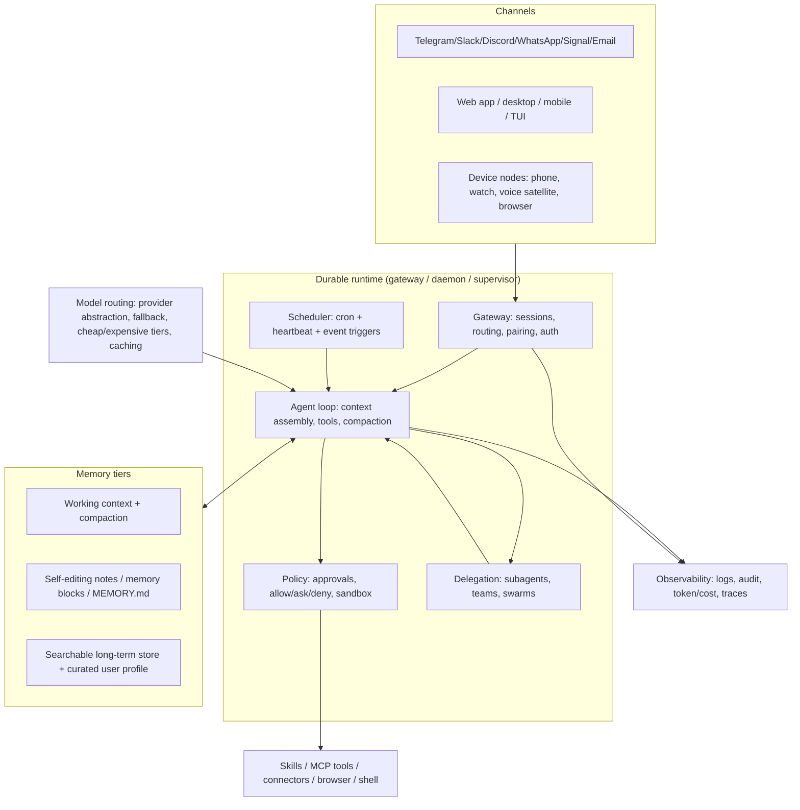

# The personal AI assistant landscape (beyond OpenClaw and Hermes)

*Research note for DSH v0.2.2-rc.1, compiled 2026-11-09. Scope: adjacent projects and their approaches, the recurring architecture of always-on personal agents, a cross-project feature matrix, and the cross-cutting hard problems. Claims are checked against primary sources (project READMEs, docs, blogs) where possible; repo metadata (stars, language, licence, activity) comes from the GitHub API on 2026-11-09 and will drift. Where public information is thin, that is stated rather than padded.*

## 1. Why assistants are converging on "coding agent + always-on runtime"

Three lineages collided in 2025–2026:

1. **Memory-first agents** — MemGPT/Letta treated the context window as a managed resource the model edits (memory blocks, self-editing memory, later "sleep-time compute" / dreaming). See [MemGPT](https://arxiv.org/abs/2310.08560) and Letta's [memory-blocks post](https://www.letta.com/blog/memory-blocks).
2. **Coding agents** — Claude Code, Codex and their clones proved a general-purpose agent loop: shell + file tools, sandboxing, skills, subagents, MCP. They were the first agent harnesses good enough to do arbitrary work on a real machine.
3. **Workflow automation** — n8n/Activepieces proved the value of triggers, connectors and approvals, but are graph-first rather than conversation-first.

The synthesis is now visible across the field. Letta Code describes itself as "a stateful agent harness … agents that have memory, identity, and a sense of experience over time", shipping CLI, browser/mobile chat, Telegram/Slack/Discord channels, crons and heartbeats ([letta-code README](https://github.com/letta-ai/letta-code)). Open Interpreter is now "a coding agent optimized for low-cost models" — a Rust fork of OpenAI's Codex with native sandboxing, ACP and computer use ([README](https://github.com/OpenInterpreter/open-interpreter)). Goose is "your native open source AI agent — desktop app, CLI, and API — for code, workflows, and everything in between" ([README](https://github.com/aaif-goose/goose)). OpenClaw is the gateway-first expression: "one Gateway runs it as a personal claw … in the channels you already use" ([README](https://github.com/openclaw/openclaw)). Google's Gemini Spark is the cloud expression: a 24/7 agent whose core is "Tasks, Skills and Schedules", running on Google Cloud VMs ([announcement coverage](https://gigazine.net/gsc_news/en/20260520-google-gemini-spark)). Manus 2.0 bundles its in-house harness ("Cascade"), event-triggered Automations and a purchasable Cloud Computer ([Manus 2.0](https://manus.im/blog/introducing-manus-2-0)). And the DIY expression, Claudex, is literally Claude Code + a Telegram channel plugin + hooks + cron + systemd ([README](https://github.com/JansenAnalytics/claudex)).

The reason is economic and architectural: the *harness* (tool loop, context management, sandbox, skills, subagents) is now commoditised, and what turns a harness into an assistant is a short list of missing halves — durability, a chat surface you already use, memory that survives sessions, proactivity (cron/heartbeat/events), and a policy layer for acting without a human at the terminal. Every project below adds those halves starting from a different side.

## 2. Projects and their approach

**Letta / MemGPT — memory as the product.** Memory blocks are labelled, size-capped units of the context window that the agent can rewrite (persona, human, learned context); "sleep-time" agents rewrite shared memory during idle periods ([Letta research](https://www.letta.com/blog/memory-blocks)). Current source is `letta-code`, not the retired V1 API server in the `letta` repo ([README](https://github.com/letta-ai/letta)). Letta Code adds channels (Telegram/Slack/Discord/custom), crons and heartbeats, subagents, permission modes, hooks, "MemFS" (all context git-tracked, optionally synced to a GitHub repo), remote computers, and cloud-hosted agent state ([README](https://github.com/letta-ai/letta-code)). It is the clearest "personal agent with a memory API" play; LettaBot, the earlier personal-assistant wrapper, is archived and superseded by Letta Code channels ([repo](https://github.com/letta-ai/lettabot)).

**Open Interpreter — pivot to low-cost coding agent.** The old Python "run code on your machine" assistant now lives on only as a community fork (`endolith/open-interpreter`). The new Rust product is a Codex fork with harness emulation (`/harness` switching between claude-code, kimi-code, qwen-code, deepseek-tui, swe-agent, minimal), ACP support for editors, and shared `AGENTS.md` / `.agents/skills` conventions ([README](https://github.com/OpenInterpreter/open-interpreter)). Lesson: "computer use assistant" alone did not sustain; the coding-agent harness did.

**Goose (Block → AAIF/Linux Foundation).** Rust desktop app + CLI + API, 15+ providers (including using existing Claude/ChatGPT/Gemini subscriptions via ACP), 70+ MCP extensions, custom distributions ([README](https://github.com/aaif-goose/goose)). General-purpose but local-first; no built-in messaging gateway, so it is a *harness* that others (or the user) wrap.

**Fabric (Daniel Miessler) — prompts, not an agent.** Go CLI + REST API + web UI around a large library of Markdown "patterns", per-pattern model mapping, contexts and sessions; multi-provider including subscription OAuth ([README](https://github.com/danielmiessler/fabric)). It solves the *integration* problem for AI tasks (summarise, extract, write) rather than the *always-on* problem. Useful as a skills/pattern library and as an API for other assistants.

**Agent Zero — the agent with its own Linux computer.** Open-source agent in a sandboxed Linux workspace with an in-browser desktop (XFCE, Blender, LibreOffice), managed browser with DOM annotation, "Projects" that isolate memory/secrets/knowledge per job, Plugin Hub, multi-agent delegation, A2A, and "Time Travel" workspace snapshots ([README](https://github.com/agent0ai/agent-zero)). Strong on *computer work*; weak on messaging-first personal presence.

**Khoj — "AI second brain".** Semantic search and chat over personal docs (PDF, Markdown, Notion, Word, org-mode), local or online LLMs, agents with custom knowledge/persona/tools, automations and newsletters delivered by email, access from browser/Obsidian/Emacs/desktop/phone/WhatsApp ([README](https://github.com/khoj-ai/khoj)). New sibling Pipali is an open-source "AI coworker that runs on your computer" ([README](https://github.com/khoj-ai/khoj)). Khoj shows retrieval-first assistants can survive commercially (cloud + enterprise) without a gateway.

**Suna → Kortix CompanyOS — the pivot to multi-agent company OS.** `kortix-ai/suna` now redirects to `kortix-ai/CompanyOS` (formerly Suna, the generalist agent). It is a cloud-native harness: custom "pi" agents, event triggers (schedules, signed webhooks, connector events, merged change requests), one session per cloud computer that sleeps and wakes with full history, "My Kortix" router agent, swarms, Outcomes with verifier sessions, 3,000+ connectors, Allow/Ask/Block per tool, change-request approvals, audit log, SSO/SCIM, per-project encrypted secrets ([README](https://github.com/kortix-ai/CompanyOS)). The licence metadata is ambiguous ("NOASSERTION") despite "open source" language — treat openness claims with care. The pivot from personal generalist to company OS is itself a data point about where margin is.

**Home Assistant + LLM voice — the ambient, local-first assistant.** Assist is the built-in voice assistant: fully local or cloud, wake words, ESPHome satellites (a $13 voice remote), Android "Hey Jarvis", analog-phone mode, and an optional LLM conversation agent for more conversational requests ([Assist docs](https://www.home-assistant.io/voice_control/)). HA is the best existing example of *presence* (always-listening devices, room context, device actions) and of a hard constraint most agent projects ignore: latency and privacy budgets in voice.

**Manus — commercial general agent.** Manus 2.0 (Sept 2026) is positioned as a new architecture: "Cascade" harness (claimed 23.2% fewer tokens, 28.2% less time, 32% cheaper than its previous system), Cloud Computer, event-triggered Automations (was schedule-only), Studio desktop for documents/spreadsheets/slides/video/games, and a separate "Cue" personal-agent app that can message, make payments within a user-defined budget, and work on a dedicated machine ([Manus blog](https://manus.im/blog/introducing-manus-2-0), [coverage](https://gigazine.net/gsc_news/en/20260929-manus-2-0)). Commercial agents lead on UX and billing; they lag on local control and openness.

**The OpenClaw clone wave — verified, and large.** The [awesome-claws list](https://github.com/machinae/awesome-claws) catalogs 34 OpenClaw-inspired projects; several are now substantial (metadata 2026-11-09):

| Project | Stack | Stars | What it is |
|---|---|---|---|
| [PicoClaw](https://github.com/sipeed/picoclaw) | Go | 30.1k | Independent rewrite (not a fork), "<10MB RAM, $10 hardware", AI-bootstrapped migration; single binary, old Android phones |
| [ZeroClaw](https://github.com/zeroclaw-labs/zeroclaw) | Rust | 33.3k | Single-binary runtime, 30+ channels, `supervised` autonomy by default, OS sandboxes (Landlock/Bubblewrap/Seatbelt/Docker), cryptographic tool receipts, SOP engine, ACP |
| [nanobot](https://github.com/HKUDS/nanobot) | Python | 49.9k | "Ultra-lightweight personal agent", one-click deploy, MCP, agent social networking |
| [NanoClaw](https://github.com/nanocoai/nanoclaw) | TypeScript | 31.1k | Container-per-agent sandbox on Anthropic's Agents SDK; explicitly built because OpenClaw is too large to audit |
| [IronClaw](https://github.com/nearai/ironclaw) | Rust | 12.7k | "Agent OS" focused on privacy/security, local encrypted data, layered defences |
| [TinyClaw → TinyAGI](https://github.com/TinyAGI/tinyagi) | TypeScript | 3.6k | Multi-agent/multi-team/multi-channel orchestration; renamed, last push March 2026 (stale) |

Two things stand out. First, **security anxiety is the main clone driver**: NanoClaw's author writes that OpenClaw has "nearly half a million lines of code, 53 config files, and 70+ dependencies" with "security at the application level … rather than true OS-level isolation" ([NanoClaw README](https://github.com/nanocoai/nanoclaw)); ZeroClaw and IronClaw make hardening the headline. Second, **the wave has already consolidated**: LettaBot is archived, TinyClaw renamed and stalled, while PicoClaw/ZeroClaw/nanobot/NanoClaw are active.

**Big-company convergence (2026).** Google's **Gemini Spark** (Google I/O, May 2026) is a 24/7 personal agent on cloud VMs, built on Gemini 3.5 Flash, with Tasks/Skills/Schedules, Workspace + MCP connectors, confirmation prompts before important actions, and an AI Ultra subscription; coverage explicitly frames it as Google's answer to OpenClaw ([GIGAZINE](https://gigazine.net/gsc_news/en/20260520-google-gemini-spark)). In China the OpenClaw wave ("raising lobsters") produced **Tencent QClaw** — a GUI wrapper with 3-minute setup and a "Claw Gateway" malicious-prompt detector — plus **Alibaba CoPaw**, **Z.ai AutoClaw**, and **WeChat ClawBot** putting an OpenClaw-based agent inside WeChat ([GIGAZINE](https://gigazine.net/gsc_news/en/20260422-tencent-qclaw-openclaw)). By late 2026, "always-on personal agent" is a platform category, not a hobby project.

**DIY coding-agent-as-assistant.** The most instructive artefact is [Claudex](https://github.com/JansenAnalytics/claudex): Claude Code as a Telegram-connected daemon with a `CLAUDE.md` identity, 161 Markdown skills, 9 subagent definitions, MCP servers, tmux + systemd + watchdog cron, a SQLite FTS5 + vector memory index, a curated `USER.md` profile, a task inbox, and 2-hourly memory curation that reads each transcript exactly once by byte offset. It documents the failure modes too: `bypassPermissions` is required because nobody is at the terminal, so the *deny list* becomes the real guardrail; the Telegram plugin allows only one `getUpdates` consumer per bot token; sessions need periodic restarts; a hook-spawned `claude -p` can displace the live session's channel connection.

**n8n / Activepieces — the automation substrate.** n8n (fair-code, self-hostable) has 1,500+ integrations and markets "multi-step AI workflows with logic, tool use, human approvals, and full observability" ([README](https://github.com/n8n-io/n8n)). Activepieces (MIT) exposes its 280+ TypeScript "pieces" automatically as MCP servers for LLMs and has an AI SDK for flows ([README](https://github.com/activepieces/activepieces)). Neither is chat-first, but they are where triggers, connectors and approval gates are already mature — a natural tool layer for an assistant rather than a competitor to it.

## 3. The recurring architecture pattern

Every serious assistant in this survey is the same ten-layer stack with different ownership of the layers:

1. **Durable runtime** — a gateway/daemon that owns sessions and survives disconnects (OpenClaw Gateway, Hermes gateway, Letta App Server, Kortix cloud computers, claudex systemd+tmux).
2. **Channel adapters** — inbound/outbound messaging with pairing, allowlists and per-channel session isolation. This is the single biggest differentiator between "agent" and "assistant".
3. **Agent loop** — context assembly, tool calls, compaction; increasingly borrowed from coding-agent harnesses (Codex/Claude Code lineage).
4. **Memory tiers** — working context; self-editing notes (memory blocks, `MEMORY.md`, `USER.md`); searchable long-term store (FTS5/vector) and a curated profile. The frontier is *curation and provenance*, not storage.
5. **Scheduler** — cron plus heartbeat ("wake every N minutes and decide whether to act") plus event triggers (webhooks, email, connector events). Manus, Kortix, Gemini Spark and OpenClaw all moved from schedule-only to event-triggered in 2026.
6. **Skills/tools** — Markdown skills + MCP servers + shell/browser/device tools. ClawHub, Hermes Skills Hub and agentskills.io are emerging cross-project skill registries.
7. **Policy/approvals** — permission modes, allow/ask/deny lists, chat-based approval cards, and sandboxing. The unsolved UX is approving an action from a phone without training the user to tap "yes".
8. **Delegation** — subagents, teams, swarms; the difference between one chat and a workforce.
9. **UI** — Control UI/desktop/mobile/TUI; increasingly the messaging app *is* the UI.
10. **Model routing** — provider abstraction, fallback chains, per-task model tiers, prompt caching and subscription-OAuth backends (Claude Max, ChatGPT/Codex, Kimi) to control cost.

What is commoditised: tool loops, MCP, Markdown skills, basic sandboxing, provider abstraction. What still differentiates: channel breadth and reliability, memory curation quality, proactive behaviour that is useful rather than noisy, and the trust/policy layer.

## 4. Feature matrix

Legend: ● shipped and central, ◐ partial/optional/DIY, ○ not a core feature. Hermes and OpenClaw rows are from their READMEs; see Sources.

| Capability | Hermes | OpenClaw | Letta Code | Goose | Coding-agent-as-assistant (Claudex) |
|---|---|---|---|---|---|
| Always-on runtime | ● gateway process | ● Gateway daemon | ● app server / cloud | ◐ desktop/CLI, API | ◐ systemd + tmux + watchdog |
| Messaging channels | ● Telegram, Discord, Slack, WhatsApp, Signal, Email, Home Assistant | ● 20+ (Discord, iMessage, Slack, Teams, Telegram, WhatsApp, Signal, Matrix, …) | ● Telegram, Slack, Discord, custom | ○ (ACP/API; MCP) | ◐ Telegram plugin |
| Memory | ● curated memory + user profile, FTS5 search, Honcho modelling | ● memory architecture, search, provenance/deletion, dreaming | ● memory blocks, MemFS (git), dreaming | ◐ session + MCP memory servers | ● files + SQLite FTS5/vector |
| Scheduling / heartbeat | ● cron with platform delivery | ● automations, cron, heartbeat | ● crons, heartbeats | ○ | ◐ cron + 5-min watchdog |
| Skills / tools | ● skills hub, MCP | ● skills + ClawHub, MCP | ● skills, subagents, MCP | ● 70+ MCP extensions | ● 161 Markdown skills + MCP |
| Approvals / security | ● command approval, DM pairing, container isolation | ● pairing, allowlists, exec approvals, sandbox modes | ● permission modes | ● tool permissions, prompt-injection detection, adversary mode | ○ bypassPermissions + deny list |
| Delegation | ● subagents | ● subagents, swarms, ACP agents | ● subagents, agent-to-agent | ● subagents and subrecipes | ● subagent definitions |
| UI surface | ● TUI, desktop, web app | ● Control UI, desktop/mobile apps, nodes | ● TUI, web/mobile chat, desktop | ● desktop app, CLI | ○ messaging app only |
| Model routing | ● many providers, per-subagent models | ● provider plugins, failover | ● `/model`, cloud | ● 15+ providers, subscription via ACP | ○ single flat-rate subscription |
| Self-improvement | ● skill creation/curation, memory nudges | ● skills, self-learning docs | ● memory/skill learning, harness "mods" | ○ | ◐ deterministic memory curation + skill audit |
| Multi-device | ◐ Termux/Android, desktop | ● companion apps + nodes | ● remote computers | ◐ desktop/CLI anywhere | ○ single trusted box |
| Licence | MIT | MIT | Apache-2.0 | Apache-2.0 | MIT |

## 5. Hard problems

**5.1 Inbound prompt injection and untrusted content.** The defining security problem: an assistant reads email/DMs/web pages (untrusted input), has access to private data, and can send messages externally — Simon Willison's "lethal trifecta" ([Willison, 2025](https://simonwillison.net/2025/Jun/16/the-lethal-trifecta/)). Meta's "Agents Rule of Two" formalises the mitigation: an agent session should satisfy no more than two of [A] untrusted inputs, [B] sensitive data/systems, [C] state change or external communication; if all three are needed, require human supervision or a fresh session ([Meta AI, Oct 2025](https://ai.meta.com/blog/practical-ai-agent-security/)). Guardrail classifiers are not a fix (Willison: "95% is very much a failing grade"). Practical implication for personal assistants: every messaging channel is an attacker-controlled input, and every assistant that can read mail and send mail is one poisoned email away from exfiltration unless the policy layer breaks the chain.

**5.2 Permission boundaries and approvals.** Unattended operation removes the human who would click "allow". Claudex's answer is `bypassPermissions` plus a deny list, and it is explicit that the deny list is the *only* guardrail that fires ([Claudex README](https://github.com/JansenAnalytics/claudex)). ZeroClaw defaults to `supervised` autonomy (medium-risk asks, high-risk blocked) and issues cryptographic tool receipts ([ZeroClaw README](https://github.com/zeroclaw-labs/zeroclaw)). OpenClaw ships conservative defaults: loopback-only gateway, unknown DM senders get a pairing code instead of being processed, group access allowlisted behind a mention gate ([OpenClaw security docs](https://docs.openclaw.ai/gateway/security)). The unsolved part is approval *UX*: chat-based approvals either interrupt long jobs or become rubber stamps.

**5.3 Memory hygiene.** Memory that the agent writes is memory that can be poisoned, duplicated, contradicted or silently bloated. Letta's answer is structured, size-capped blocks plus idle-time rewriting and provenance ([Letta](https://www.letta.com/blog/memory-blocks)); Hermes keeps curated `MEMORY.md`/`USER.md` and nudges the agent to persist knowledge ([README](https://github.com/NousResearch/hermes-agent)); Claudex curates on a 2-hour cron with dedupe, a ~500-token profile cap, date-tagged provenance, and contradictions recorded as corrections rather than overwrites ([README](https://github.com/JansenAnalytics/claudex)). OpenClaw documents memory provenance and deletion ([docs](https://docs.openclaw.ai)). The pattern: memory needs a *write policy* (what is durable vs transient), a *curator* that runs out-of-band, and a *forget* path — not just a vector store.

**5.4 Cost and latency.** Always-on means always-paying: heartbeats, cron jobs, channel polling and re-read context all consume tokens. Responses: subscription backends (Claude Max via Claude Code, ChatGPT/Codex OAuth, Goose ACP subscription auth, Fabric's Claude Code plugin), cheaper harnesses and model tiers (Manus Cascade's claimed 23.2% token reduction; Open Interpreter's low-cost-model focus), prompt caching (OpenClaw docs discuss prompt caching and token costs), and routing cheap models to summarisation/heartbeat work. Latency is the other budget: local voice pipelines must beat cloud round-trips to feel like a house assistant, which is why HA supports fully local Assist.

**5.5 Messaging-bridge reliability and ToS risk.** Unofficial WhatsApp bridges (WhatsApp Web protocol) violate WhatsApp's Terms of Service and accounts can be permanently banned; the official Cloud API does not carry that risk ([comparison](https://github.com/nicolaischmid/pons/blob/b1265daded6a7905648583c0a7d3de59827ccdf5/content/blog/whatsapp-mcp-server-vs-personal-bridges.mdx)). Reliability is also structural: Telegram allows one `getUpdates` consumer per bot token (a documented Claudex gotcha), channel plugins rot across restarts, and delivery failures are silent unless watched — hence watchdog health checks and restart strategies ([Claudex](https://github.com/JansenAnalytics/claudex)). Any DSH messaging plugin inherits both problems: pick official APIs where possible, and build delivery observability from day one.

**5.6 Sandboxing.** There are two schools: application-level permission checks (allowlists, pairing, approvals) and OS-level isolation (containers, Landlock, Seatbelt, VMs). NanoClaw exists because its author judged OpenClaw's application-level security insufficient ([README](https://github.com/nanocoai/nanoclaw)); ZeroClaw runs OS sandboxes with tool receipts ([README](https://github.com/zeroclaw-labs/zeroclaw)); OpenClaw offers Docker/Podman/SSH/OpenShell backends ([docs](https://docs.openclaw.ai/gateway/security)); Open Interpreter ships native sandboxing on macOS/Linux/Windows ([README](https://github.com/OpenInterpreter/open-interpreter)); Kortix gives every session its own cloud computer ([README](https://github.com/kortix-ai/CompanyOS)). For a coding-agent harness this is familiar ground, but assistant use raises the stakes: the agent now acts on *personal* data, on a schedule, with no human watching.

**5.7 Multi-device identity.** An assistant that lives in chat and on a phone needs pairing, per-device credentials, session continuity and a notion of "which machine is this action running on". OpenClaw has companion apps, nodes, pairing and remote access via Tailscale/Cloudflare ([README](https://github.com/openclaw/openclaw)); Letta has remote computers and cloud state ([README](https://github.com/letta-ai/letta-code)); Manus sells a Cloud Computer and a remote-desktop-from-phone app ([Manus](https://manus.im/blog/introducing-manus-2-0)). Getting identity right is a product problem (account model, device trust, revocation), not a plugin detail.

**5.8 Secrets and observability.** Assistants accumulate credentials (mail, calendar, banking, messaging) and act in places where mistakes are expensive. Letta obfuscates secret values from context while exposing them as env vars ([README](https://github.com/letta-ai/letta-code)); OpenClaw documents a secrets/vault layer (SecretRefs, 1Password plugin) and OpenTelemetry export ([docs](https://docs.openclaw.ai)); Kortix keeps credentials server-side and adds audit logs, change requests and per-project encryption ([README](https://github.com/kortix-ai/CompanyOS)); n8n markets audit trails and observability for AI workflows ([README](https://github.com/n8n-io/n8n)). The gap everywhere is *human-readable* observability: users need to answer "what did it do while I slept, with what, at what cost, and can I undo it?"

**5.9 Self-improvement without an oracle.** Hermes creates skills after complex tasks and improves them in use; Letta agents rewrite memory, skills, prompts and even harness "mods"; OpenClaw has skill self-learning. Claudex is refreshingly honest that prose skills have no ground-truth oracle, so it uses deterministic, audited curation hooks instead of an unsupervised rewrite loop ([Claudex](https://github.com/JansenAnalytics/claudex)). Anyone adding self-modification to a personal assistant needs a review/rollback story.

## 6. What this means for DSH

Observed from the installed package inventory (`@deepseek-ai/dsh@0.2.2-rc.1`, 330 packages under `node_modules/@deepseek-ai`) and the DSH README. Detail belongs in `dsh-audit.md`; these are the landscape-level implications.

1. **DSH already owns the harness half.** Agent loop, compaction, sandbox (`dsh-sandbox`, `dsh-bash-sandbox`), skills (`dsh-skill*`), MCP (`dsh-mcp-client`), subagents and experimental agent teams, goals, headless/ACP/SDK entry modes, web GUI, session persistence/search, OTel telemetry and approval/permission primitives are shipped. That is exactly the commodity layer the market has converged on — a good starting position.
2. **The missing half is a channel/runtime layer.** No shipped package in the `@deepseek-ai` namespace provides Telegram/Discord/Slack/WhatsApp channel adapters or inbound sender pairing, and the shipped long-lived process is the web host rather than an assistant gateway with proactive wake-ups. A Telegram-first channel bundle is the highest-leverage assistant plugin; Slack/Discord follow cheaply once the adapter interface exists.
3. **Scheduling exists but proactivity does not.** `dsh-schedule` / `schedule_*` tools deliver prompts to sessions; what is missing is the *heartbeat* pattern (wake on an interval, decide whether to act, stay quiet otherwise) and event triggers (webhook/email/connector). This is plugin-shaped: a heartbeat/automation bundle on top of the existing scheduler and job system.
4. **Memory is the biggest plugin-shaped gap.** DSH has storage, session persistence and session search, but no self-editing memory blocks, curated user profile, or out-of-band memory curator. A memory plugin (notes + SQLite FTS/vector + curator job + provenance/forget path) is well-scoped and is the single feature users notice most.
5. **Approvals need to become channel-aware, and that is a hard product problem.** DSH's approval/permission UI assumes a web client. An always-on assistant must route approvals to chat, handle timeouts, and support "approve once / approve for this tool / deny forever" without training rubber-stamping. This touches core policy, not just UI.
6. **The trust boundary is the architectural decision.** OpenClaw's framing — trusted gateway, untrusted execution, policy enforced by code — maps cleanly onto DSH's plugin/profile model. Adopt it explicitly (gateway plugin holds identity/secrets/policy; agent sessions get scoped tools and sandboxes) before adding channels, or the lethal-trifecta exposure arrives by default.
7. **Prompt-injection policy must be a first-class plugin concern.** Every channel adapter should tag content provenance (operator vs external), and the policy layer should be able to enforce Rule-of-Two-style separation: external content sessions cannot combine private-data tools with external-communication tools without approval. This is a mix of plugin-shaped (provenance tagging, tool classification) and hard research (reliable detection is unsolved).
8. **Don't rebuild OpenClaw.** The clone wave shows the marginal value is in hardening and UX, not feature count; the ecosystem (ClawHub skills, MCP servers, agentskills.io conventions) is reusable from DSH via MCP and skill import. Interop beats reimplementation.
9. **Model routing and cost governance are plugin-shaped and valuable.** DSH already has provider plugins and retry; a routing/budget plugin (cheap model for heartbeat/summarisation, expensive model for user turns, per-day token budgets, prompt caching) is small and directly addresses the always-on cost problem.
10. **Voice and multi-device are later, but plan the seams.** DSH ships experimental voice-input/STT packages; the landscape says voice + presence is a different product (HA, OpenClaw nodes, Manus remote desktop). Treat them as separate plugins that consume the same session/policy layer.
11. **Observability is a differentiator waiting to be built.** Audit trail, "what happened while I was away" digest, per-session cost, and undo are what make an autonomous assistant trustworthy. DSH's OTel/telemetry and session logs give the substrate; a human-readable activity feed is plugin-shaped and high-value.
12. **Product problems to schedule deliberately:** unattended approval UX, secret vault/revocation, memory poisoning and forgetting, channel ToS/legal (WhatsApp especially), multi-device identity, and safety evaluation. These will not be solved by a plugin alone and should be scoped as product work with owners.

## 7. Where public information is thin

- Agent Zero's memory internals and long-running reliability are documented only at guide level; no independent evaluation found.
- Home Assistant's LLM conversation-agent quality/latency is community-reported; the docs describe the pipeline, not benchmarks.
- Manus Cue's payment/budget mechanics and Cloud Computer economics are marketing-level only.
- QClaw/CoPaw/AutoClaw/WeChat ClawBot details come from secondary coverage (GIGAZINE) and vendor pages; primary docs are mostly Chinese-language and thin.
- Star counts are popularity proxies, not quality signals, and move fast (OpenClaw alone is at ~394k stars on 2026-11-09).
- Kortix/CompanyOS licence metadata is "NOASSERTION"; openness claims need legal review before adoption.

## 8. Sources

Accessed 2026-11-09 unless noted.

- [Letta Code README](https://github.com/letta-ai/letta-code) — harness, channels, crons, MemFS, remote computers, secrets.
- [Letta (f.k.a. MemGPT) README](https://github.com/letta-ai/letta) — active source moved to letta-code; V1 server retired.
- [Letta: Memory Blocks](https://www.letta.com/blog/memory-blocks) — memory-block abstraction, sleep-time agents.
- [MemGPT paper](https://arxiv.org/abs/2310.08560) — self-editing memory.
- [LettaBot](https://github.com/letta-ai/lettabot) — archived; superseded by Letta Code channels.
- [Open Interpreter README](https://github.com/OpenInterpreter/open-interpreter) — Rust Codex fork, harness emulation, ACP, sandboxing.
- [Goose README](https://github.com/aaif-goose/goose) — desktop/CLI/API, 15+ providers, 70+ MCP extensions, AAIF.
- [Goose security docs](https://goose-docs.ai/docs/guides/security/) — tool permissions, prompt-injection detection, adversary mode; subagents/subrecipes via [docs](https://goose-docs.ai/docs/category/guides/).
- [Fabric README](https://github.com/danielmiessler/fabric) — patterns, REST API, per-pattern models.
- [Agent Zero README](https://github.com/agent0ai/agent-zero) — Linux workspace, projects, plugins, A2A, Time Travel.
- [Khoj README](https://github.com/khoj-ai/khoj) — second brain, agents, automations, channels.
- [Kortix CompanyOS README](https://github.com/kortix-ai/CompanyOS) — cloud harness, triggers, computers, connectors, approvals.
- [Home Assistant Assist](https://www.home-assistant.io/voice_control/) — local/cloud voice, wake words, ESPHome satellites.
- [Manus 2.0](https://manus.im/blog/introducing-manus-2-0) — Cascade, Cloud Computer, Automations, Studio.
- [Manus 2.0 / Cue coverage](https://gigazine.net/gsc_news/en/20260929-manus-2-0) — Cue app, platforms, cloud computer.
- [Gemini Spark coverage](https://gigazine.net/gsc_news/en/20260520-google-gemini-spark) — 24/7 cloud-VM agent, Tasks/Skills/Schedules, MCP, confirmations.
- [Tencent QClaw coverage](https://gigazine.net/gsc_news/en/20260422-tencent-qclaw-openclaw) — GUI wrapper, Claw Gateway, CoPaw/AutoClaw/WeChat ClawBot.
- [OpenClaw README](https://github.com/openclaw/openclaw) — gateway, 20+ channels, companion apps/nodes, security defaults.
- [OpenClaw security docs](https://docs.openclaw.ai/gateway/security) — pairing, allowlists, prompt injection, sandboxing, exposure.
- [Hermes Agent README](https://github.com/NousResearch/hermes-agent) — gateway, channels, cron, memory, skills, subagents, approvals.
- [awesome-claws](https://github.com/machinae/awesome-claws) — curated list of 34 OpenClaw-inspired agents.
- [PicoClaw](https://github.com/sipeed/picoclaw), [ZeroClaw](https://github.com/zeroclaw-labs/zeroclaw), [nanobot](https://github.com/HKUDS/nanobot), [NanoClaw](https://github.com/nanocoai/nanoclaw), [IronClaw](https://github.com/nearai/ironclaw), [TinyAGI](https://github.com/TinyAGI/tinyagi) — clone-wave projects (metadata via GitHub API, 2026-11-09).
- [Claudex](https://github.com/JansenAnalytics/claudex) — Claude Code as always-on Telegram assistant; failure modes.
- [n8n README](https://github.com/n8n-io/n8n) — workflow automation, human approvals, integrations.
- [Activepieces README](https://github.com/activepieces/activepieces) — MIT automation, pieces as MCP servers.
- [Simon Willison: The lethal trifecta](https://simonwillison.net/2025/Jun/16/the-lethal-trifecta/) — private data + untrusted content + external communication.
- [Meta: Agents Rule of Two](https://ai.meta.com/blog/practical-ai-agent-security/) — [A]/[B]/[C] constraint and supervision.
- [WhatsApp: Cloud API vs personal bridges](https://github.com/nicolaischmid/pons/blob/b1265daded6a7905648583c0a7d3de59827ccdf5/content/blog/whatsapp-mcp-server-vs-personal-bridges.mdx) — ban risk of unofficial bridges.
- DSH README at `/home/josh/dsh/node/lib/node_modules/@deepseek-ai/dsh/README.md` and installed package inventory (`@deepseek-ai/dsh@0.2.2-rc.1`, 330 packages) — local inspection, 2026-11-09.
